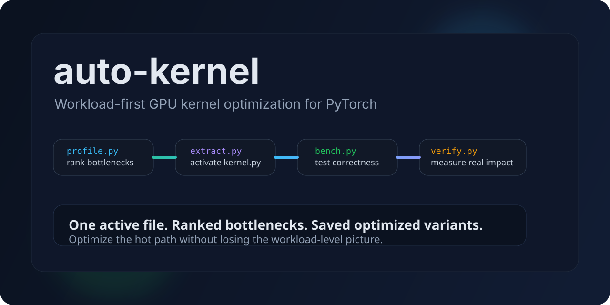

# auto-kernel



`auto-kernel` is a workload-first GPU kernel optimization loop for PyTorch models and workloads. It helps you find the real bottleneck, extract it into a single editable `kernel.py`, iterate on it, and measure whether the change improves workload-level runtime.

**[Quick Start](#quick-start)**
| **[How It Works](#how-it-works)**
| **[Model Adapters](#model-adapters)**
| **[Examples](./models)**
| **[Optimization Notes](./CUDA_OPTIMIZATION.md)**
| **[Protocol](./program.md)**

## Getting Started

Today, you can:

- benchmark the active kernel in `kernel.py`
- profile a workload into a ranked bottleneck manifest
- profile supported PyTorch models through explicit or generic adapters
- extract the top bottleneck into `kernel.py`
- save accepted optimized variants under `workspace/optimized/`
- verify projected or measured end-to-end speedups

The repository ships with `rms_norm` as the default active kernel, so the loop works immediately after setup.

## Quick Start

Make sure you have Python and PyTorch installed. The default workflow uses [`uv`](https://github.com/astral-sh/uv), but a local virtualenv works too.

### `uv` workflow

```bash
uv sync
uv run prepare.py
uv run bench.py --iterations 1 --warmup 0
```

### Local virtualenv

```bash
python3 -m venv .venv
source .venv/bin/activate
pip install -e .
python prepare.py
python bench.py --iterations 1 --warmup 0
```

To run the full optimization loop:

```bash
uv run profile.py --workload models/rms_norm_stack.py --manifest-out workspace/profile.json
uv run extract.py --profile-path workspace/profile.json
uv run bench.py --hypothesis "baseline"
uv run orchestrate.py --profile-path workspace/profile.json --results-path results.tsv
uv run verify.py --profile-path workspace/profile.json --results-path results.tsv
```

## How It Works

`auto-kernel` is built around one active file: [`kernel.py`](./kernel.py).

Instead of editing generated kernels across a large orchestration surface, you:

1. profile a workload, model, or active kernel
2. rank bottlenecks by runtime share
3. extract the highest-value kernel into `kernel.py`
4. make one focused optimization change
5. benchmark correctness and speedup versus the reference implementation
6. persist the best accepted variant
7. verify projected or measured workload-level impact

This keeps experiments reviewable, resumable, and easy to diff.

## Core Workflow

### 1. Prepare the environment

```bash
uv run prepare.py
```

This reports Python, Torch, CUDA, Triton, and Nsight Compute availability.

### 2. Benchmark the active kernel

```bash
uv run bench.py
```

This compares the active implementation in [`kernel.py`](./kernel.py) against the matching reference in [`reference.py`](./reference.py).

### 3. Profile a workload

```bash
uv run profile.py --workload models/rms_norm_stack.py --manifest-out workspace/profile.json
```

This generates a ranked bottleneck manifest so optimization time goes to the hottest kernel first.

### 4. Extract the top bottleneck

```bash
uv run extract.py --profile-path workspace/profile.json
```

This copies the selected kernel into [`kernel.py`](./kernel.py), making the next edit focused and reviewable.

### 5. Verify workload impact

```bash
uv run orchestrate.py --profile-path workspace/profile.json --results-path results.tsv
uv run verify.py --profile-path workspace/profile.json --results-path results.tsv
```

This reports the next target and the projected end-to-end speedup implied by accepted results.

## Model Adapters

`auto-kernel` supports two model integration styles:

### Explicit adapters

Use explicit adapters when a model needs custom tracing or reintegration logic.

Export:

- `trace_model(...)`
- `verify_model(...)`

### Generic adapters

Use generic adapters when the model can be expressed with a standard build-and-bind contract.

Export:

- `build_model(...)`
- `build_inputs(...)`
- optional `MODEL_TARGETS`

Each `MODEL_TARGETS` entry may include:

- `name`
- `module_name`
- `kernel_type`
- optional `kernel_path`
- optional `input_param`
- optional `input_arg`
- optional `attribute_bindings`
- optional `parameter_bindings`
- optional `constant_bindings`
- backward-compatible `weight_attr`, `bias_attr`, and `eps_attr`

If `MODEL_TARGETS` is omitted, the generic path auto-discovers supported leaf modules from `named_modules()` for common PyTorch-style classes such as:

- `RMSNorm`
- `LayerNorm`
- `Linear`
- `Softmax`

The built-in generic reintegration path is binding-driven and no longer limited to `rms_norm`.

## Repository Layout

```text
auto-kernel/
├── program.md              # optimization protocol
├── CUDA_OPTIMIZATION.md    # optimization notes and heuristics
├── MEMORY.md               # global experiment log
├── results.tsv             # experiment history
├── prepare.py              # environment validation
├── profile.py              # workload and model profiling
├── extract.py              # activate a bottleneck in kernel.py
├── bench.py                # correctness and timing harness
├── orchestrate.py          # choose the next kernel to optimize
├── verify.py               # report projected or measured workload impact
├── ncu_profile.py          # Nsight Compute analysis
├── kernel.py               # active kernel under optimization
├── reference.py            # reference implementations
├── kernels/                # baseline kernel inventory
├── models/                 # workload and model examples
├── auto_kernel/            # shared manifests and orchestration helpers
├── memory/                 # per-kernel notes
├── ncu_reports/            # profiler artifacts
├── assets/                 # README assets
└── workspace/              # manifests, active selections, and optimized artifacts
```

## Adding Your Own Kernel

Create a kernel module under [`kernels/`](./kernels) that exports:

- `KERNEL_TYPE`
- `kernel_fn(**inputs)`
- `get_inputs(...)`
- `get_flops(inputs)`
- `get_bytes(inputs)`

Then add the corresponding reference implementation in [`reference.py`](./reference.py).

To start iterating:

```bash
cp kernels/your_kernel.py kernel.py
uv run bench.py
uv run profile.py
uv run ncu_profile.py
```

## Adding Your Own Workload

Create a module under [`models/`](./models) that exports either `get_workload()` or `WORKLOAD`.

Each workload entry should include:

- `name`
- `kernel_type`
- `kernel_path`
- either `baseline_time_ms` or `input_kwargs`

See [`models/custom.py`](./models/custom.py) for a starter template.

## Current Scope

`auto-kernel` now supports generic reintegration beyond `rms_norm`, and the built-in auto-discovery path covers common module families such as `RMSNorm`, `LayerNorm`, `Linear`, and `Softmax`.

What it does not claim yet is fully profiler-driven extraction from completely untouched arbitrary PyTorch models. That last slice still benefits from model-specific adapter logic when the model boundary and kernel contract are ambiguous.

## Testing

Run the full suite with:

```bash
python -m unittest -v
```

If you are using the local virtualenv:

```bash
./.venv/bin/python -m unittest -v
```

## Requirements

- Python 3.9+
- PyTorch
- [`uv`](https://github.com/astral-sh/uv) for the default workflow
- CUDA-capable GPU and Nsight Compute for full GPU profiling

## License

[MIT](./LICENSE)
